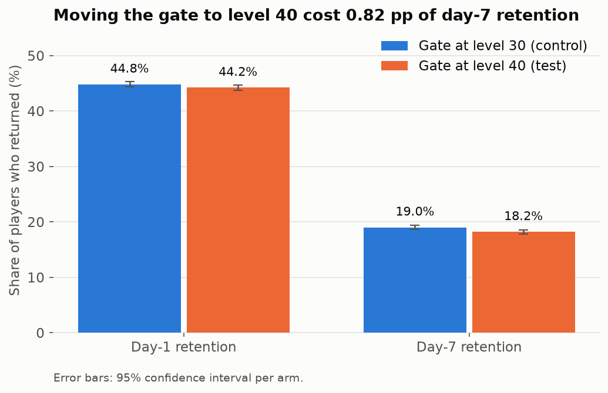
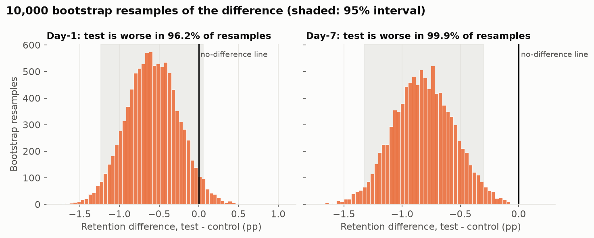
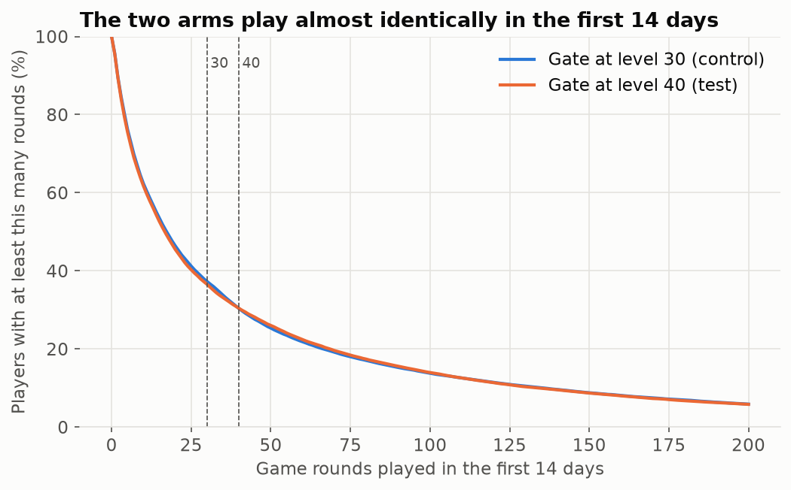
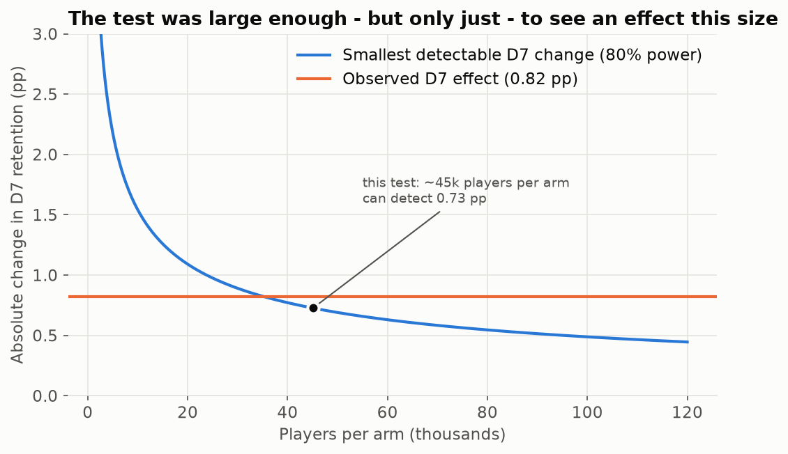

# Cookie Cats - A/B test of the first progression gate

Should the mobile puzzle game **Cookie Cats** put its first "gate" (where players must wait or pay
to continue) at **level 30** or **level 40**? This repo analyses the real experiment on
**90,189 players** and turns it into a ship / don't-ship decision with its size and its risks.
Every number below is generated from [`results/metrics.json`](results/metrics.json) by
`python -m cookie_cats` - nothing is typed by hand.

## In 30 seconds



- **Decision:** **Keep the gate at level 30.** Moving it to level 40 lowers day-7 retention, the primary metric, and no metric moves the other way.
- **Primary metric, day-7 retention:** 19.02% (gate 30) vs 18.20% (gate 40),
  a change of **-0.82 pp** (-4.3% relative), 95% CI [-1.33, -0.31] pp,
  p = 0.002 (Holm-adjusted 0.003). Bootstrap and Bayesian checks agree:
  gate 40 is worse in 99.9% of 10,000 resamples; P(gate 30 better) = 99.9%.
- **What it is worth:** for every **100,000 installs**, gate 40 keeps about **820 fewer players
  on day 7** (95% CI 312 to 1,328).
- **Secondary metrics:** day-1 retention -0.59 pp (p = 0.074, not significant on its own, same direction);
  rounds played in 14 days are flat (median 17 vs 16).
- **Caveat worth raising:** the arms are not 50/50 (44,700 vs 45,489, sample-ratio-mismatch
  test p = 0.009). I would ask the engineering team how users were assigned before treating the size of the effect as final.

## Why the gate matters

A gate is a deliberate pause: the player waits, invites friends or pays to continue. The case for
moving it later is "let players get hooked first". The case for keeping it early is that a break
*earlier* keeps players from burning out on the game (hedonic adaptation). The experiment decides
between them.

## Data

| | |
|---|---|
| Source | Kaggle [`yufengsui/mobile-games-ab-testing`](https://www.kaggle.com/datasets/yufengsui/mobile-games-ab-testing) - one row per player who installed during the test |
| Columns | `userid`, `version` (gate_30 / gate_40), `sum_gamerounds` (rounds in the first 14 days), `retention_1`, `retention_7` (came back 1 / 7 days after install) |
| Rows | 90,189 players, 0 duplicate ids, 0 missing values |
| Arms | gate_30 (control) 44,700 - gate_40 (test) 45,489 |
| Outliers | 1 player with 49,854 rounds in 14 days (> 5,000 is not human play); removed from the rounds analysis only |
| Never played | 4.4% of installs played 0 rounds |

Raw data is not committed (`data/raw/` is git-ignored); see *Reproduce* below.

## Method

1. **Trust the experiment first.** Duplicate and missing-value checks, then a **sample-ratio-mismatch (SRM)**
   chi-square test on the arm sizes. A mismatch can mean users were dropped or assigned unevenly, which
   can bias every result after it.
2. **Primary metric fixed up front: day-7 retention.** It is closer to long-term value than day-1 and is
   what the gate is meant to protect. Day-1 retention and rounds played are secondary.
3. **Three independent views of the same difference** so the conclusion doesn't rest on one method:
   two-proportion z-test with a 95% Wald interval, a 10,000-resample bootstrap, and a Beta-Binomial
   posterior. Holm correction across the two retention metrics.
4. **Power check:** what is the smallest effect this sample could reliably detect? An effect below that
   line would be noise even if it looked large.
5. **Size it** in players per 100,000 installs, the unit a product team plans with. Revenue is not
   estimated: the data has no spend or purchase column.

## Results

| Metric | Gate 30 | Gate 40 | Difference (pp) | 95% CI (pp) | p | Holm p | Detectable at 80% power |
|---|---|---|---|---|---|---|---|
| Day-7 retention (primary) | 19.02% | 18.20% | -0.82 | [-1.33, -0.31] | 0.002 | 0.003 | 0.73 pp |
| Day-1 retention | 44.82% | 44.23% | -0.59 | [-1.24, +0.06] | 0.074 | 0.074 | 0.93 pp |



**Engagement does not explain the drop.** Rounds played in the first 14 days are almost identical
(mean 51.3 vs 51.3; Mann-Whitney p = 0.051; a random gate-40 player
out-plays a random gate-30 player 49.6% of the time), and 30.3% vs
30.4% reach 40+ rounds. Players in both arms play about as much - gate-30 players are simply
more likely to *still be playing a week later*, which is what the early-break argument predicts.



Among players who came back on day 1, 33.3% (gate 30) vs 32.3% (gate 40) also came back
on day 7. This is descriptive only - it conditions on an outcome of the treatment - but it points the same way.

**The test had just enough power.** With ~45k players per arm the smallest reliably detectable day-7
change is 0.73 pp; the observed effect is 0.82 pp. The day-1 effect (0.59 pp) is below
its detectable size (0.93 pp), so "not significant" there means "too small to see", not "no effect".



## Recommendation

| | |
|---|---|
| **Ship** | Keep the gate at level 30. |
| **Why** | Day-7 retention -0.82 pp with gate 40; holds across z-test, bootstrap, Bayesian and Holm correction. |
| **Worth** | ~820 day-7 players per 100,000 installs (CI 312-1,328). |
| **Before closing** | Explain the SRM (44,700 vs 45,489, p = 0.009): check assignment logging and whether any platform or country was dropped from one arm. |
| **Not measured** | Revenue: gate position may also change purchases at the gate. Add in-app spend per player as a guardrail in the next test. |
| **Next test** | Try the gate earlier still (e.g. level 25): if the early-break effect is real it may help further; guardrail day-1 retention. |

## Limitations

- **No timestamps**: novelty effects, weekday mix and test duration can't be checked.
- **Retention is a single-day flag** ("played on day 7"), not "played at any time after day 7".
- **`sum_gamerounds` counts rounds, not levels**, so "reached the gate" can't be measured directly.
- **SRM** as above: the direction of the result is consistent across every view, but its exact size
  depends on the assignment being clean.

## Reproduce

```powershell
pip install -r requirements.txt
pip install -e .
$env:KAGGLE_API_TOKEN = "<your token>"   # or ~/.kaggle/kaggle.json
kaggle datasets download -d yufengsui/mobile-games-ab-testing -p data/raw --unzip
python -m cookie_cats      # writes results/metrics.json, figures/, README.md
pytest -q
```

## Repo layout

```
src/cookie_cats/analysis.py   checks, tests, bootstrap, Bayesian, power, sizing -> results/metrics.json
src/cookie_cats/figures.py    the four charts in figures/
src/cookie_cats/report.py     renders this README from metrics.json
tests/                        unit tests on the statistics (known answers) and on the data contract
```
